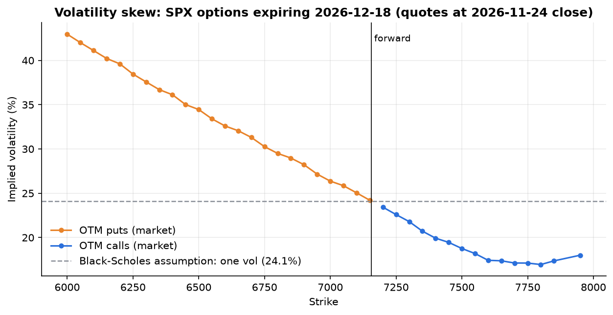
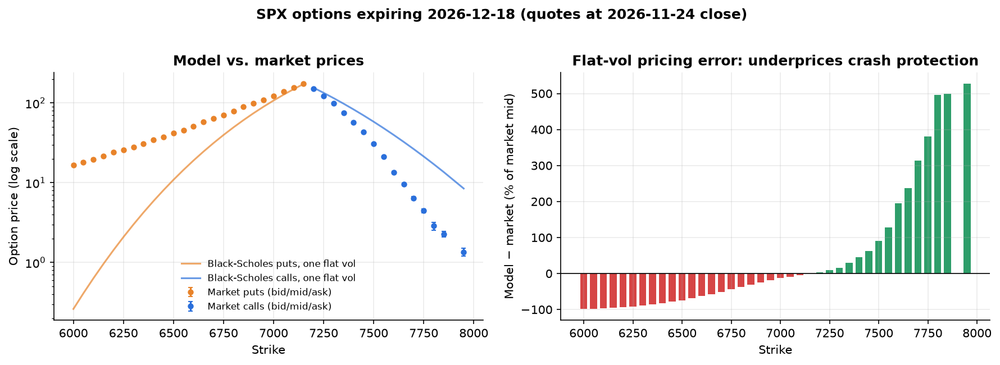
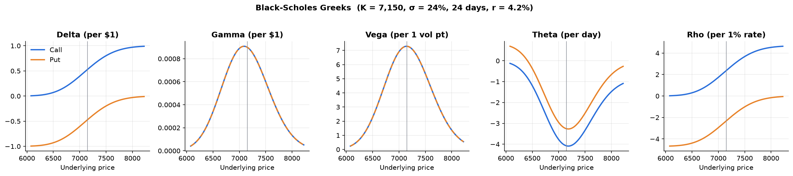
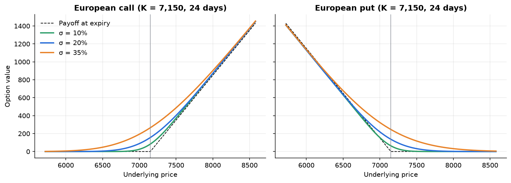
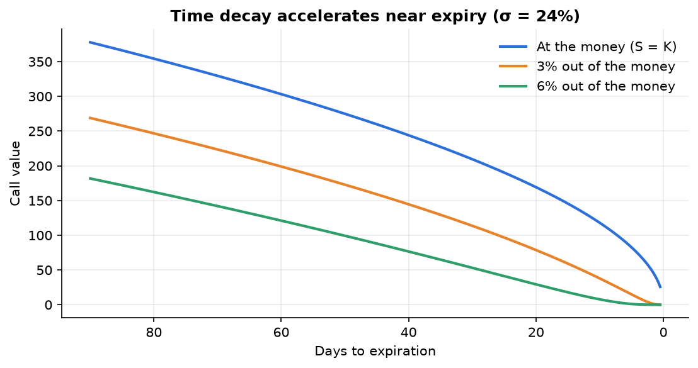

# Black-Scholes Options Pricing Model

A Python implementation of the **Black-Scholes-Merton** model that prices European calls and puts, calculates all five **Greeks**, solves for **implied volatility**, and then tests the model against **real S&P 500 (SPX) option quotes** to show where it works and where it breaks.

> **Question:** If you price every SPX option with the single volatility Black-Scholes assumes, how far off are you from what the market actually charges, and where?



## What it does

| Step | Detail |
|---|---|
| Pricing | Closed-form Black-Scholes-Merton prices for European calls and puts, with a dividend yield term |
| Greeks | Delta, Gamma, Vega, Theta and Rho in trader units (per $1, per vol point, per day, per 1% rate) |
| Implied volatility | Brent root-finding with no-arbitrage bound checks; returns NaN when no volatility can fit a price |
| Market data | 98 SPX quotes (strikes 6,000–8,400) expiring 2026-12-18, captured at the 2026-11-24 close |
| Rates & forward | Forward price backed out of **put-call parity**; parity regression cross-checks the 4.2% T-bill rate |
| Model test | Prices every out-of-the-money option with one flat volatility and measures the error by moneyness |
| Output | CSV tables, a written summary, and five charts |

## Results

<!-- RESULTS:START -->
_SPX options expiring 2026-12-18 (quotes at 2026-11-24 close). 88 two-sided quotes after cleaning; full detail in [results/summary.md](results/summary.md)._

**Flat-volatility Black-Scholes vs. market, by moneyness**

| Bucket                       |   Options | Avg market IV   |   Avg error ($) | Avg error (%)   | Inside bid/ask   |
|:-----------------------------|----------:|:----------------|----------------:|:----------------|:-----------------|
| Deep OTM puts (K < 90% of F) |         9 | 39.4%           |          -22.24 | -92.6%          | 0%               |
| OTM puts (90–97%)            |        10 | 31.6%           |          -30.25 | -52.9%          | 0%               |
| Near the money (97–103%)     |         9 | 24.1%           |            0.01 | 1.6%            | 11%              |
| OTM calls (K > 103%)         |        11 | 18.0%           |           20.58 | 270.3%          | 0%               |

**At-the-money contracts: price and Greeks at market implied vol**

| Contract   |   Market mid | Implied vol   |   BS price @ IV |   Delta |   Gamma |   Vega |   Theta/day |   Rho |
|:-----------|-------------:|:--------------|----------------:|--------:|--------:|-------:|------------:|------:|
| Call 7,200 |       150.35 | 23.4%         |          150.35 |   0.471 | 0.00093 |   7.28 |       -3.92 |  2.11 |
| Put 7,150  |       173.8  | 24.2%         |          173.8  |  -0.482 | 0.0009  |   7.29 |       -3.26 | -2.38 |

**Key findings**

- Put-call parity puts the forward at **7,155.7** (24 days, r = 4.2%). A parity regression with no rate assumption implies r ≈ 4.7%, close to the 4.2% 3-month T-bill rate, a useful cross-check on the inputs.
- At-the-money implied volatility is **24.1%**. The market does not use one number: the 6,000 put trades at **43.0%** IV and the 7,950 call at **18.0%**, a classic equity-index skew.
- With a single flat vol, Black-Scholes underprices deep out-of-the-money puts by **93%** on average (worst: 98% at the 6,000 strike). Investors pay up for crash protection that a lognormal model says is rare.
- The same flat vol **overprices** out-of-the-money calls by 270% on average: the market expects upside moves to be calmer than downside moves, which one volatility cannot capture.
- Errors are smallest near the money (average absolute error 11%) and grow fast in both tails: Black-Scholes works where it is calibrated and breaks down away from it.
<!-- RESULTS:END -->





| Price vs. underlying | Time decay |
|---|---|
|  |  |

## How it works

For a European call on an asset paying a continuous dividend yield *q*:

$$C = S e^{-qT} N(d_1) - K e^{-rT} N(d_2), \qquad P = K e^{-rT} N(-d_2) - S e^{-qT} N(-d_1)$$

$$d_1 = \frac{\ln(S/K) + (r - q + \tfrac{1}{2}\sigma^2)T}{\sigma\sqrt{T}}, \qquad d_2 = d_1 - \sigma\sqrt{T}$$

**Implied volatility** inverts this: find the σ that makes the model price equal the market price. Because the price is strictly increasing in σ, Brent's method is guaranteed to converge once the price is inside its no-arbitrage bounds.

**Why price off the forward:** put-call parity says C − P = S·e^(−qT) − K·e^(−rT) for every strike. Solving it across near-the-money strikes gives the forward the options are actually priced on. That handles dividends without estimating them, and it removes the timing gap between the 4:00 pm index print (7,201.09) and the delayed option quotes. This is how index option desks work. Running the same regression without assuming a rate gives an implied rate close to the 3-month T-bill, which checks the inputs.

**The test:** Black-Scholes assumes one constant volatility for every strike. Using the at-the-money implied volatility for all strikes and comparing against market mids shows how much of real-world option pricing that assumption misses.

## Project structure

```
├── main.py                     # runs the full pipeline (CLI)
├── src/options_pricing/
│   ├── black_scholes.py        # prices, Greeks, implied vol, put-call parity
│   ├── market.py               # load/clean chains, forward, smile, model-vs-market
│   └── visuals.py              # Matplotlib charts
├── notebooks/                  # step-by-step walkthrough
├── tests/                      # pytest: textbook values, parity, Greeks vs finite differences, IV round-trip
├── data/                       # SPX option chain snapshot (2026-11-24)
├── results/                    # CSV tables, stats.json, summary.md
└── visuals/                    # charts used in this README
```

A GitHub Actions workflow runs the tests and the full pipeline on every push and commits the refreshed results and charts.

## Run it

```bash
python -m venv .venv
# Windows: .venv\Scripts\activate    macOS/Linux: source .venv/bin/activate
pip install -r requirements.txt
python main.py
```

Options:

```bash
python main.py --rf 0.045                          # different risk-free rate
python main.py --live SPY                          # current chain from Yahoo Finance (needs internet)
python main.py --live SPY --expiration 2027-01-15
python -m pytest                                   # run the tests
```

Use the pricer directly:

```python
from options_pricing import black_scholes as bs
bs.price(S=7200, K=7200, T=24/365, r=0.042, sigma=0.24, kind="call")
bs.greeks(S=7200, K=7200, T=24/365, r=0.042, sigma=0.24, kind="put")
bs.implied_vol(150.35, S=7136, K=7200, T=24/365, r=0.042, kind="call")
```

## Limitations

- **European exercise only.** SPX options are European, so the model fits them. Single-stock and ETF options (including SPY) are American, and early exercise makes Black-Scholes approximate for them.
- **One expiration, one snapshot.** The test covers 24-day options on one day. The size and shape of the skew change with market conditions and maturity.
- **Mixed settlement.** The snapshot mixes AM-settled SPX and PM-settled SPXW contracts for the same date. The few hours' difference is ignored.
- **Delayed, free data.** Quotes are 15-minute delayed from Yahoo Finance, not institutional-grade, and were not captured at the same instant as the index close.
- **Constant rate and volatility.** The model's core assumptions: no jumps, no stochastic volatility, lognormal returns. The results show what those assumptions cost.

## Next steps

- Monte Carlo pricing to check the closed form and price path-dependent options (next project)
- Binomial tree for American options
- Fit a smile model (SVI or SABR) and build a full implied volatility surface across expirations
- Delta-hedging simulation to show how Gamma and Theta trade off in P&L

## Tech

Python · NumPy · SciPy · pandas · Matplotlib · yfinance · pytest

---
*Educational project, not investment advice. Market data © its owners, included as a small snapshot for reproducibility.*
